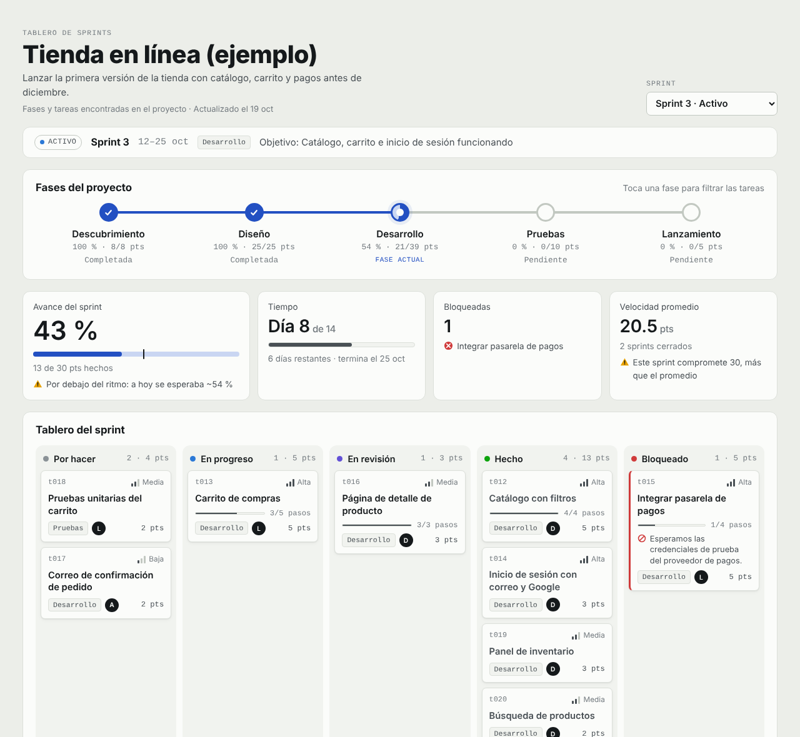

# Gestor de sprints para Claude Code

Una skill que organiza cualquier proyecto en **fases, sprints y tareas** y te los muestra en un tablero visual: línea de fases con su avance, Kanban del sprint, burndown, velocidad, bitácora de pasos y backlog.



## Qué hace

La primera vez que la usas en un proyecto:

1. **Busca lo que ya existe.** Revisa todo el repositorio: roadmaps y documentos de planeación, listas con casillas `- [ ]`, specs de agentes, comentarios `TODO` / `FIXME` en el código e issues y milestones de GitHub (si `gh` tiene sesión).
2. **Si encuentra fases o tareas, las importa** tal cual, con el archivo y la línea de donde salió cada una.
3. **Solo si no encuentra nada**, analiza el proyecto (stack, qué está hecho, qué falta, pruebas, CI, despliegue, documentación) y crea las fases y tareas, con un `ANALISIS.md` que explica cada decisión.
4. Arma el Sprint 1 con lo más prioritario y deja el resto en el backlog.

Después la usas en el día a día, hablando normal:

- «Terminé el login» · «Empecé el carrito» · «Pagos está bloqueado por las credenciales»
- «Agrega: validar formularios y pruebas del checkout»
- «¿Cómo vamos?» · «Actualiza con lo que hice» (revisa los commits)
- «Cierra el sprint» (calcula la velocidad y hace la retro) · «Inicia el sprint 3»
- «Sincroniza» (busca TODO e issues nuevos)

La skill nunca toca el código de tu proyecto. Todo lo que crea queda en una carpeta:

```text
tablero-sprints/
├── datos.js       ← fases, sprints, tareas y bitácora (lo mantiene Claude)
├── tablero.html   ← el tablero; ábrelo con doble clic
└── ANALISIS.md    ← solo si el plan salió de un análisis del proyecto
```

El tablero funciona sin servidor ni internet y se actualiza solo cuando Claude cambia los datos. En VS Code también puedes verlo con la extensión **Live Preview** (clic derecho en `tablero.html` → *Show Preview*).

## Instalación

Elige una opción. En todas necesitas [Claude Code](https://code.claude.com/docs/en/overview) (terminal o extensión de VS Code).

### Opción A. Como plugin (recomendada: sirve en todos tus proyectos)

En la terminal:

```bash
claude plugin marketplace add gaelrojo/gestor-sprints
claude plugin install sprints@gestor-sprints
```

O dentro de VS Code: en el panel de Claude Code escribe `/plugins`, agrega `gaelrojo/gestor-sprints` en la pestaña **Marketplaces** e instala **sprints** en la pestaña **Plugins**.

Úsala con `/sprints:gestor-sprints` o simplemente pidiendo «organiza los sprints de este proyecto».

Para recibir versiones nuevas: `claude plugin marketplace update gestor-sprints` y luego `claude plugin update sprints@gestor-sprints`.

### Opción B. Copiarla dentro de un proyecto (queda en el repo para todo el equipo)

Desde la carpeta del proyecto:

```bash
# macOS / Linux
curl -fsSL https://raw.githubusercontent.com/gaelrojo/gestor-sprints/main/install.sh | bash
```

```powershell
# Windows (PowerShell)
& ([scriptblock]::Create((irm https://raw.githubusercontent.com/gaelrojo/gestor-sprints/main/install.ps1)))
```

Queda en `.claude/skills/gestor-sprints/`. Haz commit de esa carpeta y tu equipo la tendrá también. Úsala con `/gestor-sprints`.

Si clonaste este repositorio: `./install.sh /ruta/al/proyecto` o `.\install.ps1 -Proyecto C:\ruta\al\proyecto`.

### Opción C. Para todos tus proyectos, sin plugin

```bash
./install.sh --global          # macOS / Linux
.\install.ps1 -Global          # Windows
```

Queda en `~/.claude/skills/gestor-sprints/`. Úsala con `/gestor-sprints`.

> Si este repositorio es privado, las opciones con `curl` / `irm` no funcionan sin credenciales: clónalo y usa `./install.sh`, o usa la opción A (Claude Code usa tus credenciales de git).

## Ver un ejemplo

Abre `ejemplo/tablero-sprints/tablero.html` en tu navegador para ver un tablero con datos de ejemplo.

## Estructura del repositorio

```text
.claude-plugin/marketplace.json          ← catálogo para instalar como plugin
plugins/sprints/
├── .claude-plugin/plugin.json
└── skills/gestor-sprints/
    ├── SKILL.md                         ← instrucciones principales
    ├── references/descubrir.md          ← cómo encontrar fases y tareas existentes
    ├── references/analizar.md           ← cómo analizar el proyecto si no hay nada
    ├── references/formato.md            ← formato de datos.js
    └── assets/tablero.html              ← plantilla del tablero
install.sh / install.ps1                 ← instaladores para copiar la skill a un proyecto
ejemplo/                                 ← tablero de ejemplo
```
